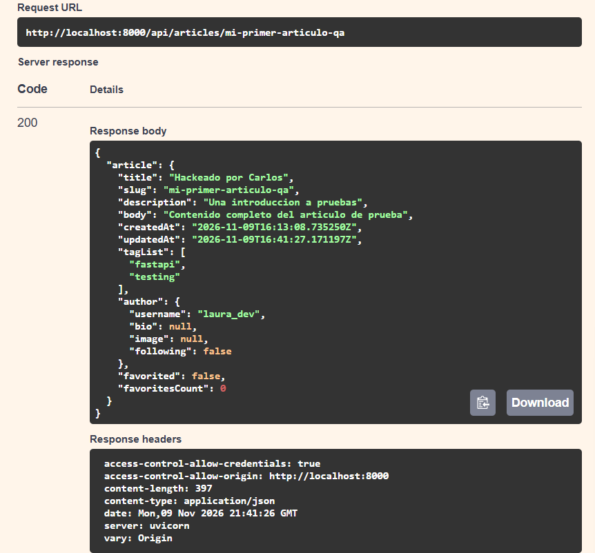
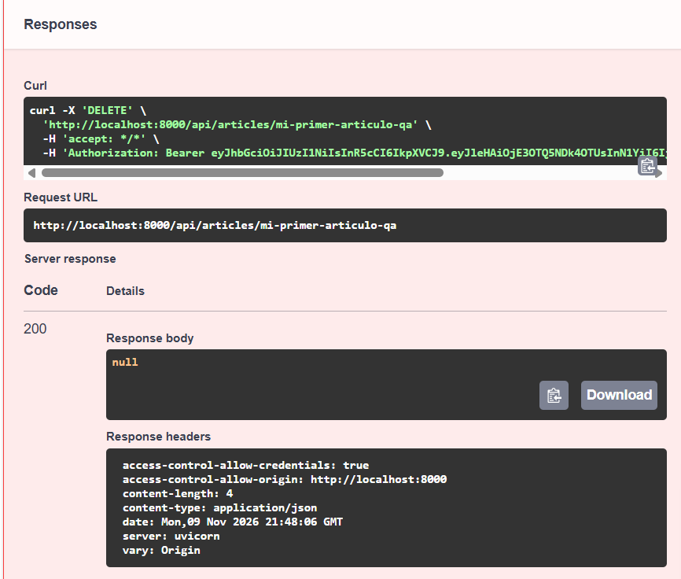
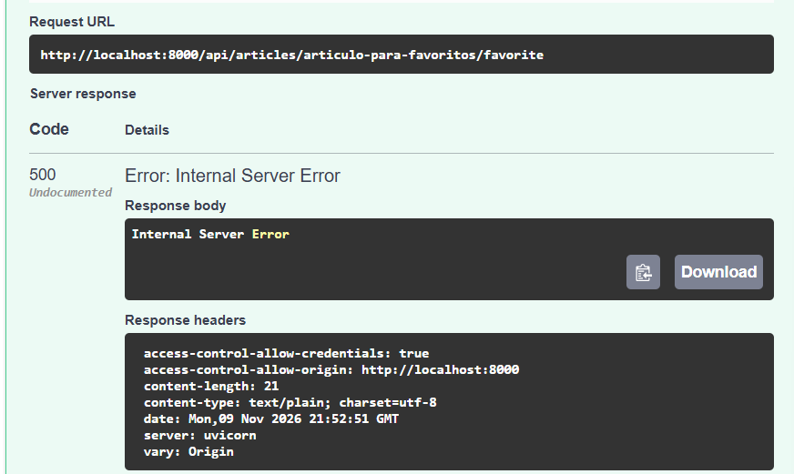
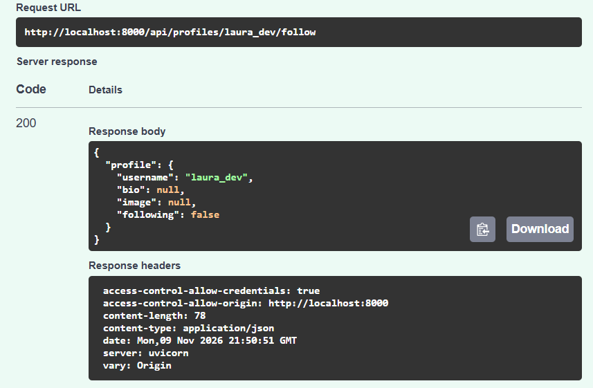
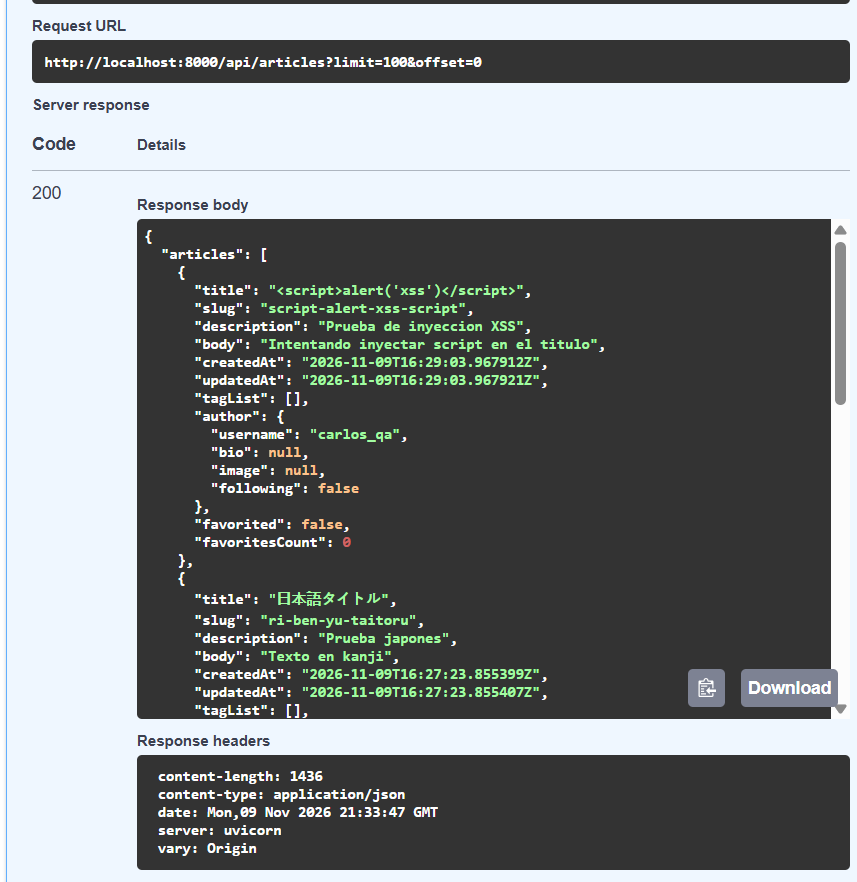

# Fichas de Reporte de Bugs para MantisBT
## Proyecto: FastAPI RealWorld Example App (Conduit)
### Suite: Ejecución contra rama `buggy-version` (Python 3.14 + PostgreSQL)

---

## Índice de Defectos Detectados

| Bug ID | Módulo | Severidad | Prioridad | Caso(s) de Prueba | Estado |
|--------|--------|-----------|-----------|-------------------|--------|
| **BUG-01** | Auth | Baja | Baja | CP-AUTH-A-001 | Confirmado (New) |
| **BUG-02** | Articles | Alta | Alta | CP-ART-A-002 | Confirmado (New) |
| **BUG-03** | Articles | Alta | Alta | CP-ART-A-005, CP-QUAL-M-003 | Confirmado (New) |
| **BUG-04** | Articles | **Crítica** | **Alta** | CP-ART-A-006, CP-QUAL-M-004 | Confirmado (New) |
| **BUG-05** | Favorites | Alta | Media | CP-FAV-A-001, CP-FAV-A-002, CP-EST-M-002 | Confirmado (New) |
| **BUG-06** | Profiles | Media | Media | CP-PRF-A-001, CP-PRF-A-002, CP-EST-M-001 | Confirmado (New) |
| **BUG-07** | Articles | Alta | Alta | CP-ART-A-007 | Confirmado (New) |
| **BUG-08** | Articles | Media | Media | CP-ART-A-008 | Confirmado (New) |
| **BUG-09** | Articles | Media | Media | CP-ART-A-009, CP-EXP-M-004 | Confirmado (New) |

---

## Ficha 1: BUG-01

```
TÍTULO:        POST /api/users retorna HTTP 200 en lugar de 201 Created al registrar usuario
CP ASOCIADO:   CP-AUTH-A-001
MÓDULO:        Auth
SEVERIDAD:     Baja
PRIORIDAD:     Baja
ENTORNO:       localhost:8000, rama buggy-version, Python 3.14, PostgreSQL (Docker)

DESCRIPCIÓN:
Al enviar una petición de registro exitosa a POST /api/users con credenciales válidas,
la API responde con código HTTP 200 OK en lugar de HTTP 201 Created estipulado por el contrato REST y la especificación RealWorld.

PASOS PARA REPRODUCIR:
1. Enviar petición POST a http://localhost:8000/api/users
2. Body JSON:
   {
     "user": {
       "username": "usuario_prueba",
       "email": "usuario_prueba@test.com",
       "password": "password123"
     }
   }
3. Observar código de estado HTTP en la respuesta.

RESULTADO ESPERADO:
HTTP 201 Created. El usuario es creado en BD y se retorna el objeto con su token JWT.

RESULTADO OBTENIDO:
HTTP 200 OK. La respuesta devuelve el JSON del usuario pero con código 200.

EVIDENCIA (pytest):
FAILED tests/test_auth.py::test_registro_retorna_201 - AssertionError: [CP-AUTH-A-001] Se esperaba HTTP 201, se obtuvo 200.

EVIDENCIA MANUAL (Swagger UI):
Captura de pantalla: CP-EXP-M-001_registro- Codigo 200 Error Creacion de Usuario.png
`

### 📸 Evidencia Adjunta para MantisBT:
Archivo a subir: docs_qa/evidencias/CP-EXP-M-001_registro- Codigo 200 Error Creacion de Usuario.png

``

---

## Ficha 2: BUG-02

```
TÍTULO:        Permite creación de artículos con título vacío (falta validación min_length=1)
CP ASOCIADO:   CP-ART-A-002
MÓDULO:        Articles
SEVERIDAD:     Alta
PRIORIDAD:     Alta
ENTORNO:       localhost:8000, rama buggy-version, Python 3.14, PostgreSQL (Docker)

DESCRIPCIÓN:
El esquema de entrada NewArticle carece de restricción min_length=1 en el campo 'title',
permitiendo crear artículos con título vacío (""). Esto viola la regla de negocio fundamental
de una plataforma de blogs y genera artículos con slug vacío o inconsistente en BD.

PASOS PARA REPRODUCIR:
1. Autenticarse como usuario válido para obtener token JWT.
2. Enviar petición POST a http://localhost:8000/api/articles con Header 'Authorization: Bearer <token>'
3. Body JSON:
   {
     "article": {
       "title": "",
       "description": "Descripción de prueba",
       "body": "Cuerpo del artículo",
       "tagList": []
     }
   }
4. Observar respuesta.

RESULTADO ESPERADO:
HTTP 422 Unprocessable Entity indicando fallo de validación en el campo 'title'.

RESULTADO OBTENIDO:
HTTP 200 OK. El sistema crea el artículo con título en blanco "" en la base de datos.

EVIDENCIA (pytest):
FAILED tests/test_articles.py::test_crear_articulo_titulo_vacio_retorna_422 - AssertionError: [CP-ART-A-002] Se esperaba HTTP 422, se obtuvo 200.
`

### 📸 Evidencia Adjunta para MantisBT:
Archivo a subir: docs_qa/reports/test_report.html (Reporte de fallo en pytest)``

---

## Ficha 3: BUG-03

```
TÍTULO:        Falla de autorización: Cualquier usuario autenticado puede editar artículos ajenos
CP ASOCIADO:   CP-ART-A-005, CP-QUAL-M-003
MÓDULO:        Articles
SEVERIDAD:     Alta
PRIORIDAD:     Alta
ENTORNO:       localhost:8000, rama buggy-version, Python 3.14, PostgreSQL (Docker)

DESCRIPCIÓN:
El endpoint PUT /api/articles/{slug} no valida que el usuario autenticado que realiza
la petición sea el autor legítimo del artículo. Como resultado, cualquier usuario con una
cuenta activa puede modificar títulos, descripciones o contenido de artículos de otros autores.

PASOS PARA REPRODUCIR:
1. Registrar Usuario A y crear un artículo con slug 'articulo-autor-a'.
2. Registrar Usuario B y autenticarse con sus credenciales.
3. Con el token del Usuario B, enviar PUT a http://localhost:8000/api/articles/articulo-autor-a
4. Body JSON:
   {
     "article": {
       "title": "Hackeado por Usuario B"
     }
   }
5. Observar respuesta y verificar en BD.

RESULTADO ESPERADO:
HTTP 400 Bad Request (o 403 Forbidden). Mensaje: "You are not the author of this article". El artículo no se modifica.

RESULTADO OBTENIDO:
HTTP 200 OK. El artículo del Usuario A es modificado exitosamente por el Usuario B.

EVIDENCIA (pytest):
FAILED tests/test_articles.py::test_editar_articulo_ajeno_retorna_400 - AssertionError: [CP-ART-A-005] Se esperaba HTTP 400, se obtuvo 200. Posible BUG-03: la verificación de autoría en PUT fue eliminada.

EVIDENCIA MANUAL (Swagger UI):
Captura de pantalla: P-QUAL-M-003_edit_ajeno_bug03.png (Carlos edita exitosamente el post de Laura recibiendo 200 OK)
`

### 📸 Evidencia Adjunta para MantisBT:
Archivo a subir: docs_qa/evidencias/P-QUAL-M-003_edit_ajeno_bug03.png

``

---

## Ficha 4: BUG-04

```
TÍTULO:        BRECHA CRÍTICA: Cualquier usuario autenticado puede eliminar artículos ajenos
CP ASOCIADO:   CP-ART-A-006, CP-QUAL-M-004
MÓDULO:        Articles
SEVERIDAD:     Crítica
PRIORIDAD:     Alta
ENTORNO:       localhost:8000, rama buggy-version, Python 3.14, PostgreSQL (Docker)

DESCRIPCIÓN:
Vulnerabilidad de control de acceso crítico en DELETE /api/articles/{slug}.
El sistema no verifica si el usuario autenticado es el propietario del artículo antes de
ejecutar la eliminación en la base de datos. Cualquier usuario autenticado puede eliminar
permanentemente el contenido de otros usuarios.

PASOS PARA REPRODUCIR:
1. Crear Usuario A y su artículo con slug 'articulo-privado-a'.
2. Crear Usuario B y autenticarse para obtener su token.
3. Con el token de Usuario B, enviar DELETE a http://localhost:8000/api/articles/articulo-privado-a
4. Verificar si el artículo sigue existiendo con GET /api/articles/articulo-privado-a.

RESULTADO ESPERADO:
HTTP 400 Bad Request (o 403 Forbidden). El artículo debe preservarse en BD.

RESULTADO OBTENIDO:
HTTP 200 OK (o 204 No Content). El artículo ajeno es borrado permanentemente de la BD por un tercero.

EVIDENCIA (pytest):
FAILED tests/test_articles.py::test_eliminar_articulo_ajeno_retorna_400 - AssertionError: [CP-ART-A-006] Se esperaba HTTP 400, se obtuvo 200. ALERTA DE SEGURIDAD (BUG-04): la verificación de autoría en DELETE fue eliminada.

EVIDENCIA MANUAL (Swagger UI):
Captura de pantalla: CP-QUAL-M-004_delete_ajeno_bug04.png (Carlos elimina artículo de Laura con DELETE /api/articles/{slug} recibiendo 200 OK y borrando el registro de BD)
`

### 📸 Evidencia Adjunta para MantisBT:
Archivo a subir: docs_qa/evidencias/CP-QUAL-M-004_delete_ajeno_bug04.png

``

---

## Ficha 5: BUG-05

```
TÍTULO:        Lógica invertida en sistema de favoritos (POST desmarca y causa error en contador)
CP ASOCIADO:   CP-FAV-A-001, CP-FAV-A-002, CP-EST-M-002
MÓDULO:        Favorites
SEVERIDAD:     Alta
PRIORIDAD:     Media
ENTORNO:       localhost:8000, rama buggy-version, Python 3.14, PostgreSQL (Docker)

DESCRIPCIÓN:
En el endpoint POST /api/articles/{slug}/favorite, la invocación al repositorio interno
llama a favorite=False en lugar de favorite=True. Esto invierte la lógica: al intentar marcar
un artículo no favorito, SQLAlchemy intenta remover al usuario de una lista donde no está
presente, provocando una excepción o impidiendo que el artículo se marque correctamente.

PASOS PARA REPRODUCIR:
1. Autenticar usuario y crear un artículo nuevo (favoritesCount = 0).
2. Enviar POST a http://localhost:8000/api/articles/{slug}/favorite con token de autorización.
3. Observar respuesta.

RESULTADO ESPERADO:
HTTP 200 OK con 'favorited: true' y 'favoritesCount: 1'.

RESULTADO OBTENIDO:
Error interno / Falla de estado: la operación no incrementa el contador y no marca el artículo como favorito.

EVIDENCIA (pytest):
FAILED tests/test_favorites.py::test_marcar_favorito_incrementa_contador - ValueError: list.remove(x): x not in list
FAILED tests/test_favorites.py::test_desmarcar_favorito_decrementa_contador

EVIDENCIA MANUAL (Swagger UI):
Captura de pantalla: CP-EST-M-002_favorite_500_bug05.png (Llamada a POST /api/articles/{slug}/favorite detona HTTP 500 Internal Server Error)
`

### 📸 Evidencia Adjunta para MantisBT:
Archivo a subir: docs_qa/evidencias/CP-EST-M-002_favorite_500_bug05.png

``

---

## Ficha 6: BUG-06

```
TÍTULO:        El perfil de usuario siempre retorna 'following: false' independientemente de la relación real
CP ASOCIADO:   CP-PRF-A-001, CP-PRF-A-002, CP-EST-M-001
MÓDULO:        Profiles
SEVERIDAD:     Media
PRIORIDAD:     Media
ENTORNO:       localhost:8000, rama buggy-version, Python 3.14, PostgreSQL (Docker)

DESCRIPCIÓN:
El método profile() del modelo User tiene hardcodeado el valor following=False.
Aunque la relación de seguimiento se registre exitosamente en la tabla intermedia follower_user,
el JSON de respuesta al consultar o seguir un usuario siempre reporta following=false.

PASOS PARA REPRODUCIR:
1. Crear Usuario A y Usuario B.
2. Autenticarse como Usuario A.
3. Enviar POST a http://localhost:8000/api/profiles/Usuario B/follow
4. Revisar el valor del campo 'profile.following' en la respuesta.

RESULTADO ESPERADO:
HTTP 200 OK con 'following: true'.

RESULTADO OBTENIDO:
HTTP 200 OK pero con 'following: false'.

EVIDENCIA (pytest):
FAILED tests/test_profiles.py::test_seguir_usuario_cambia_following_a_true - AssertionError: [CP-PRF-A-001] Se esperaba following=true después de seguir, se obtuvo False.

EVIDENCIA MANUAL (Swagger UI):
Captura de pantalla: CP-EST-M-001_follow_false_bug06.png (Llamada a POST /api/profiles/{username}/follow devuelve objeto perfil con following: false)
`

### 📸 Evidencia Adjunta para MantisBT:
Archivo a subir: docs_qa/evidencias/CP-EST-M-001_follow_false_bug06.png

``

---

## Ficha 7: BUG-07

```
TÍTULO:        Endpoint de Feed (/api/articles/feed) accesible sin autenticación (debería requerir token)
CP ASOCIADO:   CP-ART-A-007
MÓDULO:        Articles
SEVERIDAD:     Alta
PRIORIDAD:     Alta
ENTORNO:       localhost:8000, rama buggy-version, Python 3.14, PostgreSQL (Docker)

DESCRIPCIÓN:
El endpoint GET /api/articles/feed fue modificado para usar OptionalCurrentUser en vez
de CurrentUser. Al no exigir token de autenticación obligatorio, usuarios anónimos pueden
consultar el endpoint sin recibir el código HTTP 401 Unauthorized reglamentario.

PASOS PARA REPRODUCIR:
1. Enviar petición GET a http://localhost:8000/api/articles/feed sin cabecera 'Authorization'.
2. Observar código de respuesta.

RESULTADO ESPERADO:
HTTP 401 Unauthorized.

RESULTADO OBTENIDO:
Error interno 500 (AttributeError: 'NoneType' object has no attribute 'id') o HTTP 200 con lista vacía, en lugar del 401 obligatorio.

EVIDENCIA (pytest):
FAILED tests/test_articles.py::test_feed_sin_auth_retorna_401 - AttributeError: 'NoneType' object has no attribute 'id' (el endpoint intentó procesar la petición de un usuario anónimo en vez de rechazarla con 401).
`

### 📸 Evidencia Adjunta para MantisBT:
Archivo a subir: docs_qa/reports/test_report.html (Reporte de fallo en pytest)``

---

## Ficha 8: BUG-08

```
TÍTULO:        Filtro por tag (?tag=...) en GET /api/articles es ignorado y devuelve todos los artículos
CP ASOCIADO:   CP-ART-A-008
MÓDULO:        Articles
SEVERIDAD:     Media
PRIORIDAD:     Media
ENTORNO:       localhost:8000, rama buggy-version, Python 3.14, PostgreSQL (Docker)

DESCRIPCIÓN:
La cláusula de filtrado por tag en crud_article.py fue comentada.
Al enviar una petición GET /api/articles?tag=python, el sistema ignora el parámetro query
y retorna la totalidad de artículos de la base de datos sin aplicar el filtro.

PASOS PARA REPRODUCIR:
1. Tener en base de datos 2 artículos con tag 'python' y 1 artículo con solo tag 'java'.
2. Enviar petición GET a http://localhost:8000/api/articles?tag=python
3. Contar los elementos en el arreglo 'articles' y revisar 'articlesCount'.

RESULTADO ESPERADO:
HTTP 200 OK. 'articlesCount: 2'. Solo aparecen los 2 artículos etiquetados con 'python'.

RESULTADO OBTENIDO:
HTTP 200 OK. 'articlesCount: 3'. Se retornan todos los artículos existentes, incluyendo el de 'java'.

EVIDENCIA (pytest):
FAILED tests/test_articles.py::test_filtrar_articulos_por_tag - AssertionError: [CP-ART-A-008] Se esperaban 2 artículos con tag 'python', se obtuvieron 3.
`

### 📸 Evidencia Adjunta para MantisBT:
Archivo a subir: docs_qa/reports/test_report.html (Reporte de fallo en pytest)``

---

## Ficha 9: BUG-09

```
TÍTULO:        Parámetro ?limit=100 en GET /api/articles no es capeado al máximo permitido de 20 (BVA)
CP ASOCIADO:   CP-ART-A-009, CP-EXP-M-004
MÓDULO:        Articles
SEVERIDAD:     Media
PRIORIDAD:     Media
ENTORNO:       localhost:8000, rama buggy-version, Python 3.14, PostgreSQL (Docker)

DESCRIPCIÓN:
Se eliminó la función de protección min(limit, max_limit) en el controlador get_list de artículos.
Si un cliente envía un valor arbitrario alto como ?limit=100, la API devuelve hasta 100 registros
en una sola respuesta, violando la regla de negocio y análisis de valores límite (BVA: tope máximo = 20).

PASOS PARA REPRODUCIR:
1. Crear 25 artículos en la base de datos.
2. Enviar petición GET a http://localhost:8000/api/articles?limit=100
3. Contar los artículos retornados en el arreglo 'articles'.

RESULTADO ESPERADO:
HTTP 200 OK. len(articles) <= 20 (el sistema debe capear el límite solicitado al máximo de 20).

RESULTADO OBTENIDO:
HTTP 200 OK. len(articles) = 25 (el sistema devuelve todos los artículos solicitados sin capear).

EVIDENCIA (pytest):
FAILED tests/test_articles.py::test_limit_capeado_en_20_articulos - AssertionError: [CP-ART-A-009] Se esperaban máximo 20 artículos, se obtuvieron 25.

EVIDENCIA MANUAL (Swagger UI):
Captura de pantalla: CP-EXP-M-004_limit_100_bug09.png..png (Solicitud con limit=100 devuelve 25 artículos en la lista en vez del tope de 20)
`

### 📸 Evidencia Adjunta para MantisBT:
Archivo a subir: docs_qa/evidencias/CP-EXP-M-004_limit_100_bug09.png..png

``

